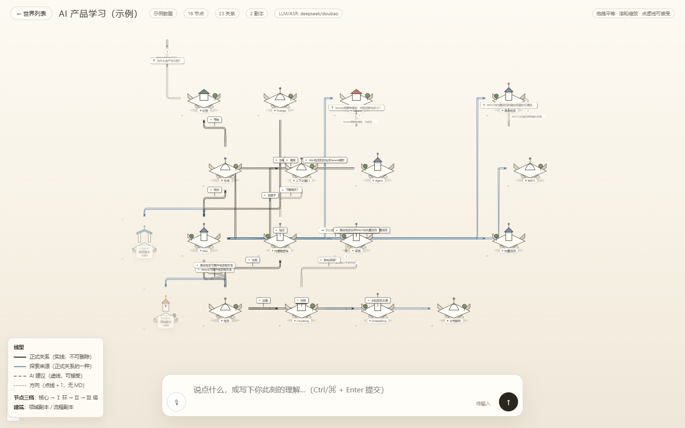
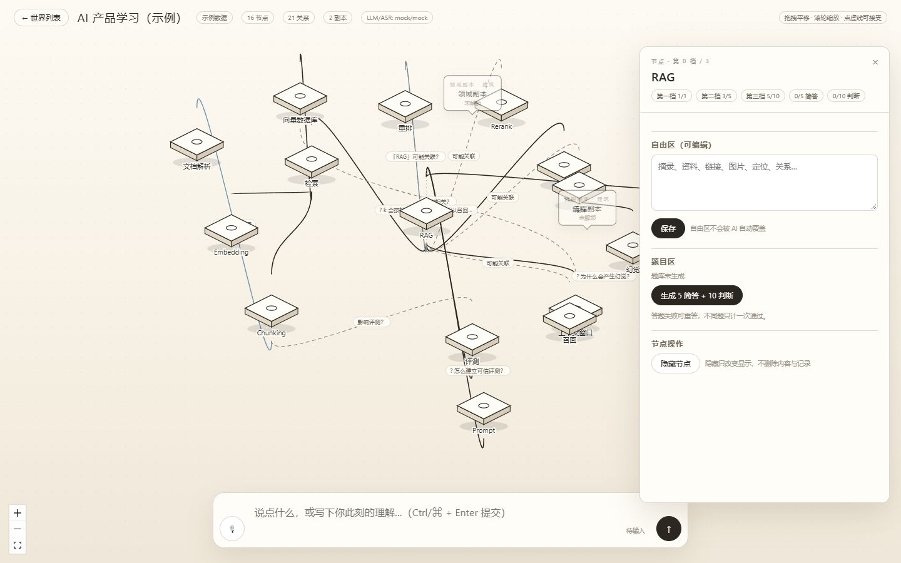
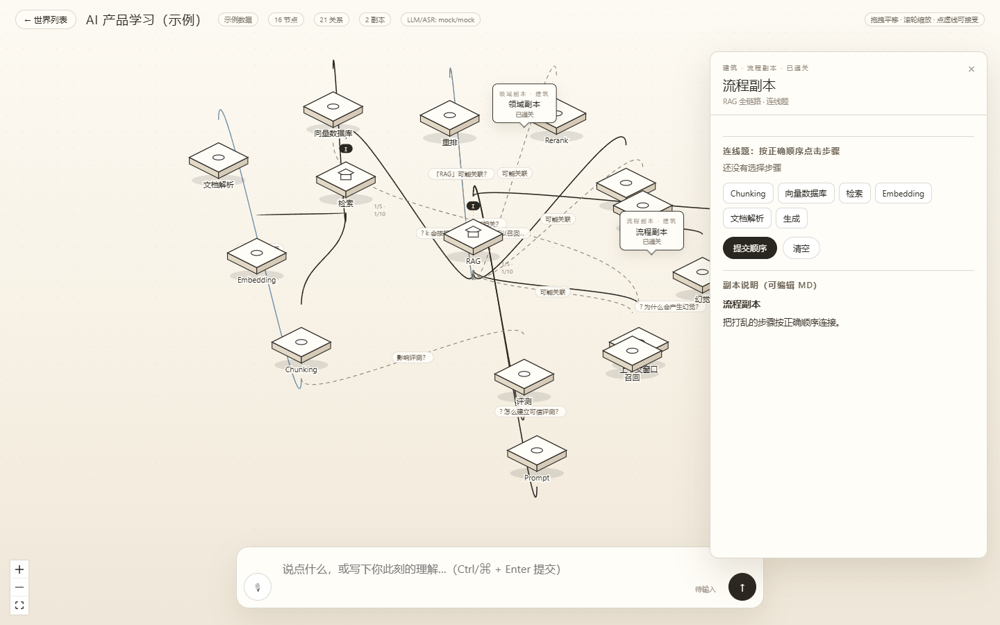
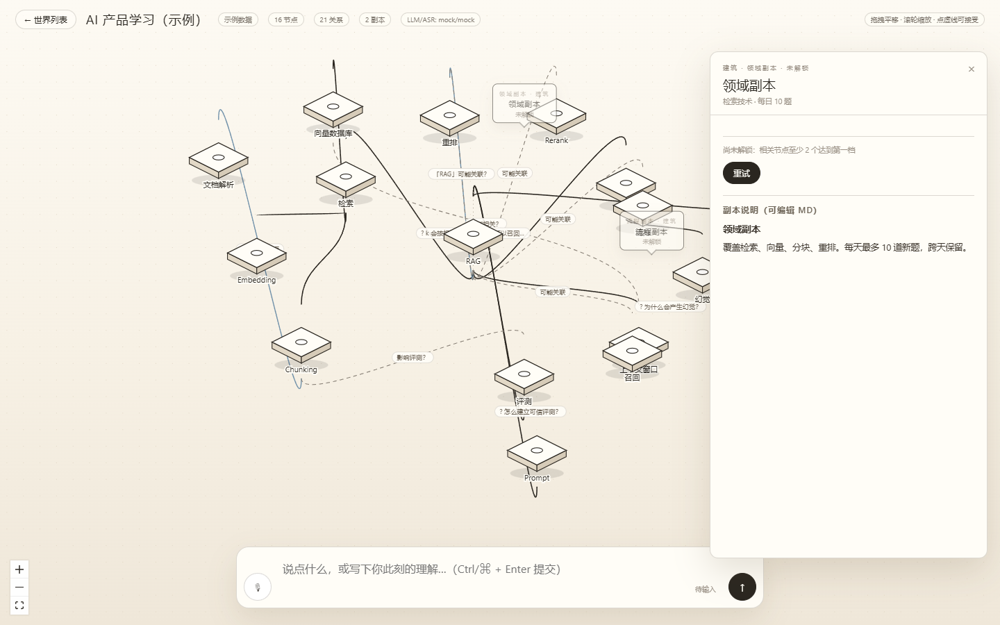

# 知识世界（blouck）· 桌面 Web MVP

把口头理解变成可继续探索、可编辑、可挑战的知识地图。
本仓库是依据两份基线文档实现的 **MVP 版本**：

- `docs/reference/knowledge-world-new-baseline-2026-11-13.md`（用户业务基线）
- `docs/reference/knowledge-world-desktop-mvp-v1.0.md`（电脑版 MVP 提案）

> 说明：文档中明确「前端不使用 3D 引擎」，因此本 MVP 使用
> React Flow + SVG 自定义节点实现二维图谱；仓库里没有 3D 依赖。
> 3D 浮岛样片只作为视觉参考，不进入本 MVP。

## 3D 资产与原型

- 3D 视图使用 web/public/assets3d/ 里的 GLB（21 浮岛 + 2 副本门），资产已入库；
- 原型 HTML 与生成脚本在 prototype/；
- 细节见 [docs/ASSETS.md](docs/ASSETS.md)。

## 界面



| 世界首页 | 节点抽屉（自由区 + 题目区） |
| --- | --- |
|  |  |

| 流程副本（连线排序） | 领域副本（每日练习） |
| --- | --- |
|  |  |

## 技术栈（按 MVP 文档）

- 前端：React + TypeScript + Vite、React Flow（自定义节点/边）、Zustand、
  react-markdown、CSS/SVG 动效
- 服务端：Node.js + Express + WebSocket（`ws`）
- 存储：Node 内置 SQLite（`node:sqlite`，无需编译原生模块），WAL 模式
- 预留：**DeepSeek**（语言：抽取 / 出题 / 判题）与 **豆包 / 火山引擎**（流式 ASR）

## 快速开始

```bash
pnpm install
cp server/.env.example server/.env   # 可选；不配置也能跑（mock）
pnpm dev
```

- 前端：http://localhost:5173
- 服务端：http://localhost:8787（Vite 已代理 `/api` 与 `/ws`）
- 首次启动会创建 **示例世界**（`is_demo=1`，界面上有「示例数据」标记），
  同时保留空世界新建能力。

## 配置 DeepSeek / 豆包

复制 `server/.env.example` 为 `server/.env`：

```ini
DEEPSEEK_API_KEY=sk-...
DEEPSEEK_BASE_URL=https://api.deepseek.com
DEEPSEEK_MODEL=deepseek-chat

DOUBAO_ASR_APP_ID=...
DOUBAO_ASR_TOKEN=...
DOUBAO_ASR_CLUSTER=volcengine_input_common
```

- 未配置 key：自动使用 **mock** provider，整条链路（语音流 → 稳定文本 → 抽取 → 落图）
  都能离线跑通，方便本地验收 UI 与状态机。
- 配置后：`server/src/providers/deepseek.ts` 走真实 Chat Completions；
  `server/src/providers/doubao.ts` 是**豆包流式 ASR 的接入位**（协议说明写在文件注释里，
  当前未实现二进制帧解析，会明确降级到 mock，不伪造成已接入）。

## 已实现的 MVP 范围

| 文档要求 | 实现 |
| --- | --- |
| 世界首页：世界列表 + 新建（世界名 + 初始节点名） | ✅ |
| 地图主页面：底部输入台（左麦克风 / 右提交） | ✅ |
| 实时语音（稳定片段后抽取、临时文字只更新 UI） | ✅ WS + mock 流式；豆包接入位已留 |
| 节点：自动落图、别名复用、来源片段、无删除 | ✅ 自动落图 / 同名去重；来源存于关系 |
| 节点 MD：自由区可编辑、AI 不覆盖 | ✅ |
| 题目区：5 简答 + 10 判断、三档 1/1 · 3/5 · 5/10 | ✅ 生成、作答、判题、档位回写 |
| 关系线：正式 / 探索来源 / 虚线建议 / 方向线（无 MD） | ✅ 铁路样式折线（岛底尖端出发）+ 路牌；点路牌可看/编辑关系 MD、接受建议 |
| 建筑：流程副本（排序连线）、领域副本（每日 10 题） | ✅ 自动检测 + 挑战入口 + 通关保存 |\n| 布局 | ✅ WFC-lite 自动布局（格子坍缩，减少交叉/重叠），顶栏「WFC 重排」 |
| 实操项目副本 | ⛔ 文档明确本版先不做 |
| 隐藏：整片隐藏 + 撤回 | ⚠️ 仅实现单节点隐藏开关；整片连通性隐藏/撤回待补 |
| 关系 MD / 关系判断题三档 | ⛔ 文档标记延后 |
| 演示脚本 / VC 演示流程 | ⚠️ 示例世界可用于演示；未写脚本化演示 |

## 目录结构

```
server/
  src/env.ts               环境配置（key 只在服务端）
  src/db.ts                SQLite schema + 查询 + 示例世界
  src/index.ts             REST + WebSocket（ASR 流）
  src/providers/
    types.ts               LLM / ASR 抽象（预留位）
    mock.ts                mock：抽取/出题/判题/流式 ASR
    deepseek.ts            DeepSeek 接入
    doubao.ts              豆包流式 ASR 接入位
web/
  src/components/          Home / World / IslandNode / BuildingNode / KwEdge / Drawers / InputBar
  src/store.ts             Zustand 状态机
  src/api.ts               REST 类型与客户端
```

## 关键 API

```
GET  /api/health                          provider 状态
GET  /api/worlds                          世界列表
POST /api/worlds                          新建世界（name, rootName）
GET  /api/worlds/:id                      图谱 + 建筑 + 档位
POST /api/worlds/:id/extract              稳定文本 → 节点/关系/副本候选
PATCH /api/nodes/:id                      自由区 MD / 隐藏
GET  /api/nodes/:id/quiz                  题库与三档进度
POST /api/nodes/:id/quiz/generate         生成 5 简答 + 10 判断
POST /api/quiz/:id/answer                 判题并累计三档
POST /api/edges/:id/accept                接受虚线建议 → 正式关系
POST /api/buildings/:id/challenge         进入副本（流程/领域）
POST /api/buildings/:id/submit            提交流程顺序 / 领域答案
PATCH /api/buildings/:id                  副本 MD（与步骤）
WS   /ws/asr                              start / audio / stop → partial / final
```

## 设计取舍与未完成项

1. 文档要求「AI 自动生成副本、不能手工新建」：MVP 用**规则检测器**（节点数、拓扑排序）
   代替模型判定，接口位置在 `server/src/index.ts` 的 `detectBuildings()`，
   后续换成后端模型任务即可。
2. 语音链路的音频采集：MVP 的 mock ASR 按脚本流式输出；
   `InputBar` 已预留 `audio` 帧发送；豆包接入时补 AudioWorklet 采集即可。
3. 移动端、邀请码、多世界权限、备份演练、导出等按文档属于延后项，未实现。
4. 题库生成/判题的真实质量依赖 DeepSeek；mock 仅用于联调。

## 开发命令

```bash
pnpm dev            # server + web 并行
pnpm typecheck      # 类型检查
pnpm build          # 前端构建
```
