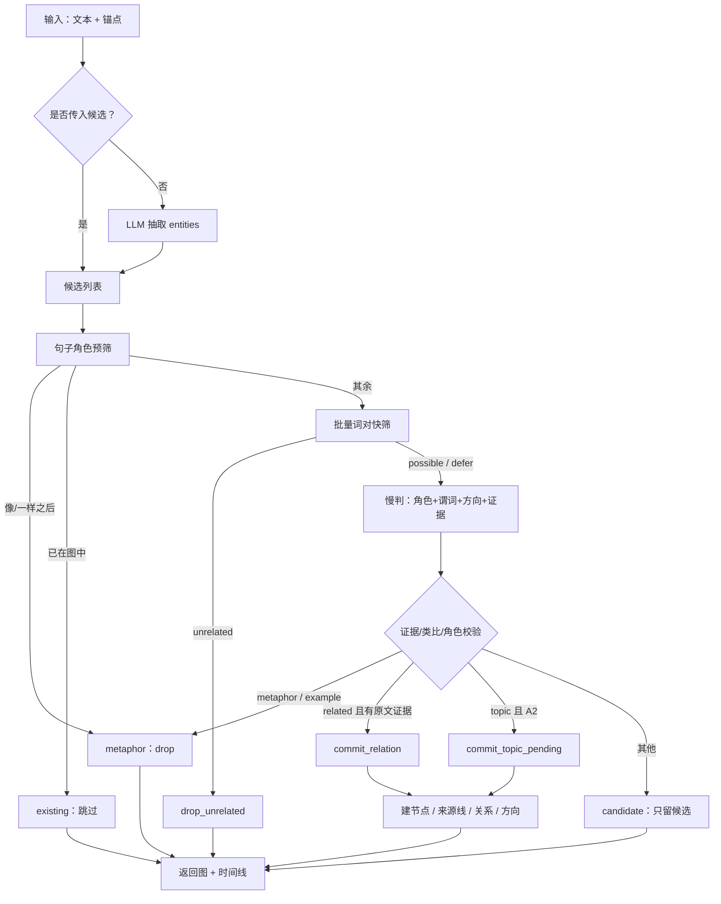

# 锚点优先生成链路：处理方式与证据状态

日期：2026-11-16
性质：dev 原型说明 + 证据审计；**不是生产实现、不是需求基线**。
代码：`server/src/anchorFirst.ts` + `POST /api/dev/anchor-first`
测试报告：`docs/reviews/anchor-first-prototype-2026-11-16.md`

---

## 1. 这条链路解决什么

用户说话/输入文本时：

1. 先确定一个**已有锚点**（如“知识库”）；
2. 从文本抽候选；
3. 先用**批量词对快筛**判断候选与锚点是否可能相关；
4. 可能相关的候选进入 provisional/候选；
5. 再用**慢判**看谓词、方向、证据；
6. 通过才 commit；否则 drop / 待确认；
7. commit 后生成方向/推荐。

目标：减少“什么都建节点”，同时避免“等关系判定太久”。

---

## 2. 处理流程图



---

## 3. 关键状态与决策

### 3.1 快筛结果

| 结果 | 含义 | 动作 |
| --- | --- | --- |
| `possible` | 同知识域/可能有关系 | 进慢判 |
| `unrelated` | 明显不同域/无已知关联 | drop，不建节点 |
| `defer` | 信息不足 | 进慢判（不丢） |

### 3.2 慢判角色

| 角色 | 处理 |
| --- | --- |
| `topic` / `subconcept` / `process` | 可建节点 |
| `metaphor` / `example` | 不建节点；只写 MD/标签 |
| `step` | 不建节点；属于流程副本 |
| `noise` | 不建节点 |

### 3.3 决策优先级（当前实现）

```text
existing（已在图中）
  > metaphor/example（drop）
  > pair=unrelated（drop）
  > related 且证据有效（commit_relation）
  > topic 且 variant=A2（commit_topic_pending）
  > candidate（只留候选）
```

### 3.4 A1 / A2

- **A1 严格**：没有知识关系就不建节点；
- **A2 话题优先**：topic 可以“关系待确认”先建，只保留来源线，不建正式知识边。

---

## 4. 当前实现状态

| 能力 | 状态 | 说明 |
| --- | --- | --- |
| 锚点加载 | ✅ | dev 接口 |
| 候选抽取 | ✅ | 不传候选时调 LLM extract |
| 句子角色预筛 | ⚠️ | 只覆盖“像/一样/如同/似的” |
| 批量词对快筛 | ✅ | 一次 LLM，多候选 |
| 慢判 | ✅ | 角色/谓词/方向/证据/无关 |
| 证据校验 | ✅ | evidence 必须是原文子串（允许前 16 字） |
| 类比不建正式关系 | ✅ | label/evidence 含类比/比喻/举例 → related=false |
| commit 节点/关系 | ✅ | formal/suggest 两档 |
| 方向 | ✅ | 慢判 direction；缺失用占位 |
| 推荐 | ⚠️ | 只返回，不自动建边 |
| provisional 持久化 | ❌ | 只在决策层，没有 ghost 表/UI |
| 修复/重连 | ❌ | 只有 drop/commit，没有 relink/tombstone |
| 多锚点 | ❌ | 只支持单锚点 |
| 实时 ASR partial | ❌ | 当前是文本输入 |
| graphVersion/幂等 | ❌ | 未实现 |
| 副本/出题联动 | ❌ | 不在本切片范围 |

---

## 5. 证据状态：哪些有参考，哪些是假设

### 5.1 有参考/可引用的部分

| 内容 | 参考 | 说明 |
| --- | --- | --- |
| 从文本抽实体/关系 | REBEL（[ACL 2021](https://aclanthology.org/2021.findings-emnlp.204/)）、DeepKE、GraphRAG、Graphiti | 证明“抽取可行”，不证明“节点准入” |
| 先剪枝候选实体对，再给 LLM | [LLM with Relation Classifier for DocRE（arXiv 2408.13889）](https://arxiv.org/abs/2408.13889) | 支持“快筛/剪枝”这一步 |
| LLM 会硬找关系 | [ACL 2024 Spurious Associations](https://aclanthology.org/2024.findings-acl.545/) | 支持证据校验、不要盲信 related |
| 关系词表/方向/传递 | SKOS（[W3C](https://www.w3.org/TR/skos-reference/)）、ISO 1087、ConceptNet（[Relations](https://github.com/commonsense/conceptnet5/wiki/Relations)）、OBO RO（[RO](https://obofoundry.org/ontology/ro.html)） | 支持 kindOf/partOf/related 等；不覆盖 RAG 领域谓词 |
| 前置关系 | Knowledge Spaces（[KST](https://github.com/vanderbilt-data-science/knowledge-spaces)） | 支持 prerequisite 的理论建模 |
| 教育概念图 | Novak 概念图 / [ACL 2025 Concept Map](https://aclanthology.org/2025.ldk-1.10/) | 支持“概念图抽取很难”的判断 |

### 5.2 没有直接参考、属于本项目假设的部分

| 假设 | 状态 | 需要验证 |
| --- | --- | --- |
| 句子级角色预筛（像/一样之后=喻体） | ❌ 无直接参考 | 换种比喻是否有效 |
| 角色分类 topic/subconcept/example/metaphor/step/noise | ❌ 无现成 KG 实现 | 30 句角色准确率 |
| 批量词对快筛的阈值/语义 | ⚠️ 只做了小样本 | 50–100 对 P/R |
| A1/A2 两种产品策略 | ❌ 产品假设 | 用户测试 |
| provisional/ghost 层 | ❌ 未实现 | 需要 UI/状态 |
| 两阶段修复/重连 | ❌ 未实现 | 修复率/级联 |
| 证据必须是原文子串 | ⚠️ 工程规则 | 模型改写证据时是否误杀 |
| 决策优先级 | ⚠️ 原型规则 | role=noise 与 related=true 的冲突 |

**结论：这条链路的“组件”有参考，但“完整串联顺序/角色/门控/修复”没有现成开源或论文直接证明，属于本项目假设，必须靠测试/用户验证。**

---

## 6. 端到端测试结果（含候选抽取）

| 场景 | 总耗时 | 抽取 | 快筛 | 慢判 | 结果 |
| --- | ---: | ---: | ---: | ---: | --- |
| 雪白 A1 | 2758ms | 1242ms | 930ms | 585ms | 知识库；RAG 不建；无喻体节点 |
| 雪白 A2 | 3280ms | 1273ms | 989ms | 1003ms | 知识库 + RAG（仅来源线） |
| 检索 | 2932ms | 913ms | 807ms | 1199ms | RAG + `formal related 使用/检索` + 方向 |
| 包含 | 4644ms | 1673ms | 1189ms | 1728ms | 5 节点；混合检索仍 `partOf`（错） |

详细结果见测试报告 §9。

---

## 7. 已知遗漏

1. **provisional/ghost 没有持久化**：A2 的“待确认”只是决策状态，没有表/UI；
2. **修复/重连未实现**：没有“发现更合适的已有节点后重连”，也没有 tombstone；
3. **实时流式未接**：当前是文本输入，不是 ASR partial；
4. **多锚点未支持**：一句话提到多个已有节点时只取一个；
5. **推荐未应用**：`recommendations` 只返回，不建虚线边；
6. **证据校验未测改写**：只测了原文子串；
7. **谓词仍会错**：包含句把混合检索判成 partOf；
8. **无 graphVersion/幂等**：重复调用/并发可能重复建节点；
9. **节点位置未分布**：所有新节点放在锚点右侧固定位置；
10. **未联动副本/题目**：commit 后没有触发 dungeon/quiz。

---

## 8. 下一步

1. 先修 `partOf vs kindOf vs related`：用问题链/谓词测试题，不要只靠一次 prompt；
2. 补 provisional 表 + ghost UI + 时间线；
3. 补修复/重连（至少：drop 后查已有节点，能连则连）；
4. 把 ASR partial 接进来，测 time-to-ghost / time-to-commit；
5. 建 50–100 对 gold 集，测角色、快筛、谓词、证据；
6. 加 graphVersion/幂等，避免重复节点。

---

## 9. 参考

- REBEL：https://aclanthology.org/2021.findings-emnlp.204/
- DocRE 分类器+LLM：https://arxiv.org/abs/2408.13889
- LLM 虚假关联：https://aclanthology.org/2024.findings-acl.545/
- SKOS：https://www.w3.org/TR/skos-reference/
- ISO 1087：https://www.iso.org/standard/20057.html
- ConceptNet Relations：https://github.com/commonsense/conceptnet5/wiki/Relations
- OBO RO：https://obofoundry.org/ontology/ro.html
- Knowledge Spaces：https://github.com/vanderbilt-data-science/knowledge-spaces
- ACL 2025 Concept Map：https://aclanthology.org/2025.ldk-1.10/

---

*本文只描述 dev 原型的处理方式与证据状态；不是生产方案，也不改变需求基线。*
