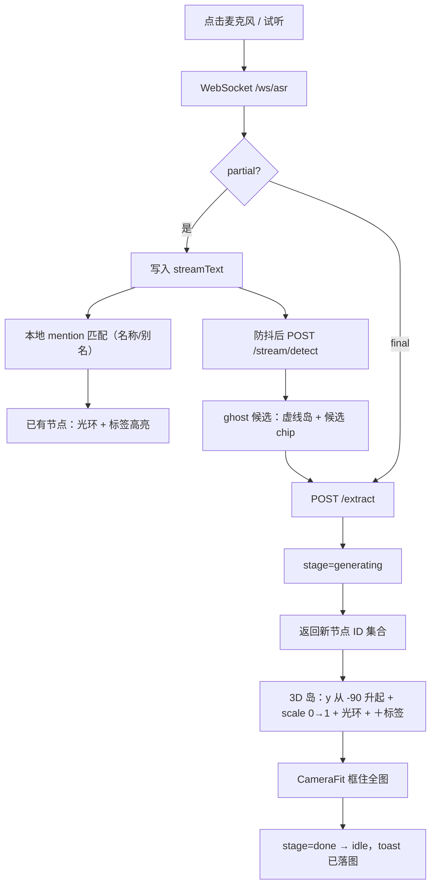

# 流式语音生成：交互、动效与实现

日期：2026-11-16
状态：已接入真实前端（dev 可运行），不是纯文档方案。
入口：World 页底部输入台；`试听` 用 mock ASR 体验，麦克风走真实 `/ws/asr`。

---

## 1. 用户看到的过程

```text
点击麦克风 / 试听
  → 底部出现"聆听 → 检测 → 确认 → 生成"四段状态
  → 边说边出 partial 字幕
  → 已存在的节点立刻亮起（金色/蓝色光环）
  → 候选实体以 ghost 形式浮在锚点旁边（虚线、浮动）
  → 说完后进入"确认/生成"
  → 新节点从地面升起（缩放 + 上浮），带光环和"＋"标签
  → 相机自动框住新图
  → "已落图 N 个新节点" toast
```

---

## 2. 流程图



---

## 3. 状态机

| stage | 触发 | UI |
| --- | --- | --- |
| `idle` | 初始/结束 | 只显示输入台 |
| `listening` | 开始录音 | 麦克风脉冲、"聆听"点亮 |
| `detecting` | 收到 partial | partial 字幕、已有节点光环、"检测"点亮 |
| `confirming` | 检测到候选 | ghost 候选 chip/虚线岛、"确认"点亮 |
| `generating` | final 后调用 extract | "生成中…"、"生成"点亮，ghost 保留 |
| `done` | extract 返回 | 新节点升起、相机 fit、toast；2.4s 后回 idle |

---

## 4. 动效清单

| 元素 | 效果 | 实现 |
| --- | --- | --- |
| 新节点 | 从 -90 高度升起，scale 0→1，ease-out | `World3D.tsx` `Island` 的 `appearing` + `useFrame` |
| 新节点光环 | 金色环脉冲 | `torusGeometry` + 透明度/缩放动画 |
| 新节点标签 | 金色边框 + "＋" 浮动 | `.n3d-label.new` / `.spark` |
| 已识别节点 | 蓝色光环 + 标签高亮 | `mentioned` + `.n3d-label.mentioned` |
| ghost 候选 | 半透明圆盘、虚线环、浮动、虚线标签 | `GhostIsland` + `.n3d-label.ghost` |
| 流式状态 | 四段进度点、active 脉冲 | `.stream-step` / `@keyframes pulseDot` |
| partial 字幕 | 打字光标 | `.stream-caption .caret` |
| 麦克风 | 录音脉冲环 | `.mic.rec` + `@keyframes micPulse` |
| 相机 | 新图出现后自动 fit | `CameraFit`（节点数变化触发） |

截图：

- 候选 ghost：`docs/screenshots/stream-ghost-ok.png`
- 生成后：`docs/screenshots/stream-generated-ok.png`

---

## 5. 实现位置

| 文件 | 作用 |
| --- | --- |
| `web/src/components/InputBar.tsx` | 麦克风/WS、partial、mention 匹配、detect 请求、四段状态、试听 |
| `web/src/store.ts` | `streamText/mentions/ghosts/stage/newNodeIds`；extract 新节点追踪 |
| `web/src/components/World3D.tsx` | `Island` 升起/光环、`GhostIsland`、mention 高亮、相机 |
| `web/src/styles.css` / `styles3d.css` | 流式面板、chip、ghost、动效 |
| `server/src/index.ts` | `/api/worlds/:id/stream/detect`（只抽候选，不落图）、`/stream/preview`（完整决策，未接前端） |
| `server/src/anchorFirst.ts` | 锚点优先链路；preview 使用 |

---

## 6. 已验证

用 Edge headless + CDP 实际点击"试听"：

- `partial` 字幕出现；
- 已有节点"检索"高亮；
- detect 返回后 ghost `重排` 出现（chip + 3D 虚线标签）；
- final 后进入 generating，ghost 保留；
- extract 返回后新节点 `重排/召回率/精排` 带"＋"升起，相机 fit；
- stage 走到 done。

store 观测：

```text
t=2500ms stage=generating ghosts=["重排"] chips=["已识别 · 检索","候选 · 重排"]
t=done   labels=["检索","重排＋","召回率＋","精排＋"]
```

---

## 7. 已知限制

1. **最终落图仍走现有 `/extract`**，不是 anchor-first apply；detect 只是预览，两者候选可能不完全一致；
2. **detect 阈值是 10 字符 + 每句一次**，不是逐词实时；ghost 出现有 1–2s 延迟；
3. **detect 和 extract 各调一次 LLM**，成本和延迟翻倍；
4. **ghost 没有确认/拒绝交互**，目前只是视觉预览；
5. **没有真正"每个词都建节点"**，仍是句末生成；
6. **mock ASR 脚本固定**，真实麦克风需要浏览器授权与豆包 ASR 配置；
7. **3D 动效依赖 WebGL**，低端设备可能掉帧；
8. **没有修复/重连**：ghost 与最终节点不一致时，没有 reconciliation。

---

## 8. 下一步

1. ghost 点击可确认/忽略，确认后再 commit；
2. detect 与 extract 合并成一次调用，避免重复 LLM；
3. 把 anchor-first apply 接成最终落图链路（或对比现有 extract）；
4. 加"生成中"增量返回，而不是等整包；
5. 真实 ASR 下测 time-to-first-ghost / time-to-commit；
6. 移动端布局与性能。

---

*本文记录已实现的流式语音交互与动效；最终生成链路仍是现有 extract，anchor-first 只用于预览。*
