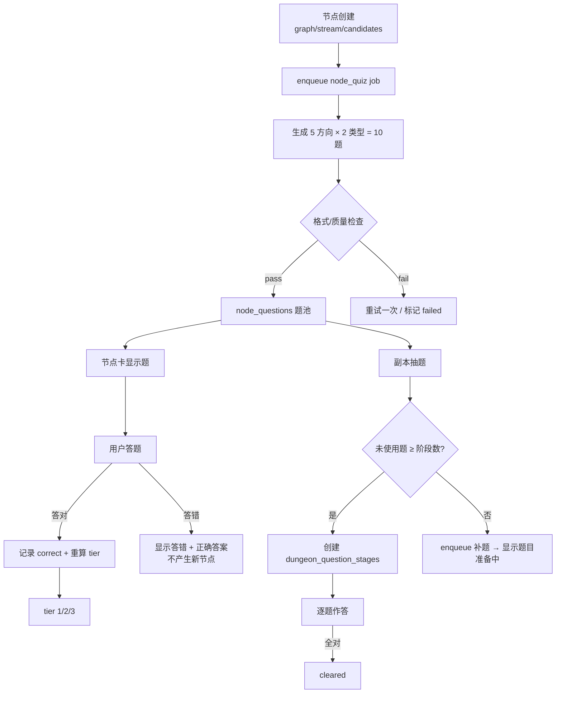
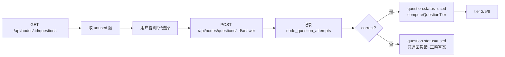
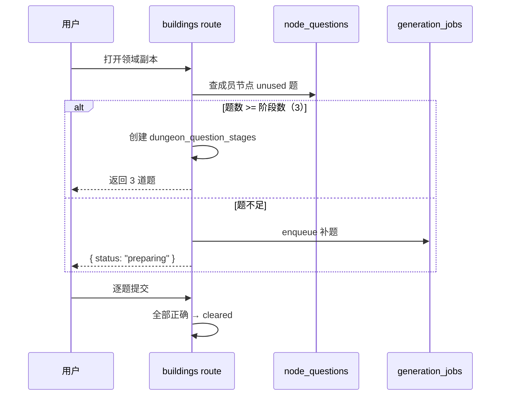
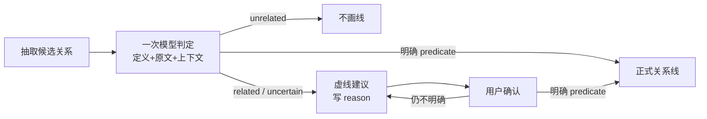

# 落地实施方案（节点题 / 节点 / 副本）

> 只写当前要做的三件事：**节点题、节点升级、副本消费题池**。
> 关系线单独一链，不阻塞题目。
> 现状代码：`server/src/routes/graph.ts`、`stream.ts`、`candidates.ts`、`nodes.ts`、`buildings.ts`、`providers/*`、`web/src/components/NodeDrawer.tsx`、`DungeonDrawer.tsx`。

## 0. 一句话

```text
节点创建 → 按 5 个方向生成 10 道判断/选择题 → 存入题池
→ 节点答题 → 答对累计升级；答错只显示答错
→ 副本从成员节点题池抽题 → 题不够就补 → 全对通关
```

**题目只依赖节点词，不依赖关系线、不依赖用户理解、不产生新节点。**

---

## 1. 现状与目标

| 现在 | 目标 |
|---|---|
| 旧 `quizzes`：打开节点可能生成 5 简答 + 10 判断 | 新 `node_questions`：5 方向 × 2 类型 = 10 题，判断/选择 |
| 题目从 definition 自由生成，句式生硬 | 按方向蓝图生成，自然题干 + 同领域干扰项 |
| 答题与 tier 走旧 `attempts/computeTier` | 新 `node_question_attempts` + `computeQuestionTier` |
| 副本走关系理解题 `understanding_tasks` | 领域副本从成员节点题池抽题；旧关系副本保留不动 |
| 题目生成在打开时/点击时 | 节点创建时异步预生成；题池不足时后台补 |

---

## 2. 总流程图



---

## 3. 数据表

```sql
CREATE TABLE IF NOT EXISTS node_questions(
  id TEXT PRIMARY KEY,
  node_id TEXT NOT NULL,
  world_id TEXT NOT NULL,
  direction TEXT NOT NULL,        -- upper | lower | process | domain | boundary
  question_type TEXT NOT NULL,    -- choice | judge
  stem TEXT NOT NULL,
  options_json TEXT NOT NULL DEFAULT '[]',
  answer TEXT NOT NULL,
  status TEXT NOT NULL DEFAULT 'unused', -- unused | used | retired
  quality_json TEXT NOT NULL DEFAULT '{}',
  created_at INTEGER NOT NULL,
  used_at INTEGER
);
CREATE INDEX IF NOT EXISTS idx_node_questions_node ON node_questions(node_id, status);

CREATE TABLE IF NOT EXISTS node_question_attempts(
  id TEXT PRIMARY KEY,
  question_id TEXT NOT NULL,
  node_id TEXT NOT NULL,
  correct INTEGER NOT NULL,
  at INTEGER NOT NULL
);

CREATE TABLE IF NOT EXISTS dungeon_question_stages(
  id TEXT PRIMARY KEY,
  building_id TEXT NOT NULL,
  stage INTEGER NOT NULL,
  question_id TEXT NOT NULL,
  created_at INTEGER NOT NULL
);
```

不新增：

- frame / claim / relation_claim；
- 用户理解表；
- 新节点推荐表；
- 新题型（只有 choice / judge）。

---

## 4. 节点题生成链

### 4.1 触发

节点创建后统一调用：

```ts
enqueueNodeQuizJob(nodeId, worldId)
```

三个入口：

- `server/src/routes/graph.ts`：extract 创建节点；
- `server/src/routes/stream.ts`：stream commit 创建节点；
- `server/src/routes/candidates.ts`：候选确认创建节点。

### 4.2 生成

`generation_jobs.type = 'node_quiz'`，worker 调 `generateNodeQuestions(node)`：

```ts
generateNodeQuestions({
  name, definition, type
}) -> NodeQuestionDraft[10]
```

固定 5 个方向 × 2 类型：

| direction | 判断 | 选择 |
|---|---|---|
| upper | 错误归类/常见误解 | “最接近哪一类？” |
| lower | 缺组件还成不成立 | “通常包含哪组环节？” |
| process | 顺序/下一步/能否省略 | 场景问下一步 |
| domain | 是否同领域/常一起出现 | 哪组会出现在同一张图 |
| boundary | 能否替代/是不是同一种东西 | 哪种说法更准确 |

### 4.3 题目质量检查

`validateNodeQuestion(item, node)`：

- 题型只能 `choice` / `judge`；
- judgment 答案只能是“对/错”；
- choice 3–4 个选项、只有一个正确、无“以上都对/都不对”；
- 题干不得是“X 是什么”；
- 选项不能明显跨领域（足球/烘焙）；
- 题干/选项不能空；长度上限；
- 不能靠一个关键词直接匹配答案；
- 同一节点题干 hash 去重。

质量不过：整批重试一次；仍失败则只保存通过项，job 标 `failed`，前端显示“题目准备中”。

### 4.4 自然题风约束

Prompt 必须写：

```text
用老师口吻，不要出现“上位/下级/领域/关联/边界”这些词。
判断题用“接入 RAG 后，模型就不会再产生幻觉。”这种可判断的断言。
选择题给场景，干扰项来自同领域/近邻概念，不能一眼假。
一题只考一个点；答案唯一。
不要解释，不要推荐新节点。
```

示例（RAG）：

```text
判断：接入 RAG 后，模型就不会再产生幻觉。  → 错
判断：RAG 的检索阶段可以省略，只要模型足够强。 → 错
选择：用户问了一个知识库里没有现成答案的问题。RAG 接下来最可能做什么？
      A. 先检索相关资料，再交给生成模型
      B. 直接重新训练模型
      C. 只返回知识库原文
      D. 关闭检索，直接生成
```

### 4.5 补题机制

```text
unused < 4          → 补到 10
节点 definition/type 修改 → 旧题 retire，重新生成
题目质量检查失败     → 补 1 道
副本抽题后不足       → 触发对应节点补题
```

约束：

- 每节点最多保留 30 道；
- 同题干 hash 去重；
- 每节点每天最多补 1 次；
- 生成中不重复 enqueue。

---

## 5. 节点答题/升级链



### 5.1 答题 API

```text
GET  /api/nodes/:id/questions
POST /api/nodes/questions/:id/answer { answer: string }
```

返回：

```json
{
  "correct": true,
  "answer": "A",
  "tier": 1,
  "correctCount": 3
}
```

答错不返回解释、不创建节点、不修改关系。

### 5.2 升级规则

按**不同题目答对数**：

| tier | 需要答对 |
|---|---|
| 1 | 2 |
| 2 | 5 |
| 3 | 8 |

- 同一题只算一次；
- 答错也标记 used，不反复刷同一题；
- 升级只写 `nodes.tier`，和旧 quiz 的 tier 分开计算；
- `refreshBuildingStatus` 照旧使用 `nodes.tier`，副本解锁自动生效。

### 5.3 旧题处理

- 旧 `quizzes` / `attempts` 保留，不再驱动新 tier；
- `GET /api/nodes/:id/quiz` 已经只读；
- 新节点卡只展示 `node_questions`；
- 旧题入口下线或隐藏。

---

## 6. 副本链

### 6.1 领域副本



规则：

- 成员来自 `buildings.steps`；
- 每个副本 3 道题，来自不同成员节点的不同方向；
- 题目不够 → `preparing`，后台补题；
- 全对 → `cleared`；答错 → 保持 playable，可重试；
- 旧关系理解副本 `/sequence` 保留，不再新建给新副本。

### 6.2 流程副本

MVP 先保持现状（步骤排序），不接入节点题池。  
因为流程副本考的是顺序，不是节点概念；如果后续要统一为判断/选择，再单独做，不阻塞节点题。

### 6.3 副本出现/解锁

- 沿用 `dungeonReadiness` 和 `refreshBuildingStatus`；
- 成员节点 tier≥1 → playable；
- 讲解题池不足不影响 detected，只影响进入挑战时显示 preparing。

---

## 7. 关系线（独立链，不阻塞题目）



- 判定在候选创建时完成，不让用户点击后才生成；
- `related` 不能自动升级；
- 关系线不参与题目生成、不参与副本抽题；
- 不新增 claim/frame 表。

---

## 8. 实施顺序

| 步骤 | 改什么 | 验收 |
|---|---|---|
| 1 | `node_questions` / `node_question_attempts` / `dungeon_question_stages` schema | 迁移幂等 |
| 2 | `providers.generateNodeQuestions` + mock | 单测 10 题、5 方向、2 类型 |
| 3 | `generationWorker` 支持 `node_quiz` | enqueue 后题池出现 |
| 4 | 节点创建三入口挂 enqueue | 新节点自动有题 |
| 5 | `/api/nodes/:id/questions` + answer + tier | 答对升级、答错不建节点 |
| 6 | `NodeDrawer` 展示题池 | 手机/桌面可答 |
| 7 | 领域副本题池/阶段/通关 | 不足 preparing，全对 cleared |
| 8 | 补题触发/去重/上限 | 题池不低于 4 |
| 9 | 关系线判定（独立） | unrelated 不画，related 只虚线 |

---

## 9. 验收

```bash
pnpm typecheck
pnpm test
pnpm build
```

新增测试：

- 生成结果：10 题、5 方向、choice/judge 各 1；
- 非法题被质量检查拒绝；
- 答对 2/5/8 分别 tier 1/2/3；
- 答错只返回 `correct:false`，不产生节点/关系；
- `unused < 4` 触发补题；
- 同题干不重复；
- 领域副本题不足返回 preparing；
- 全对 cleared；
- 关系线 unrelated 不建边、related 只 suggest。

SQL 验收：

```sql
SELECT direction, question_type, COUNT(*)
FROM node_questions
WHERE node_id = ?
GROUP BY direction, question_type;
-- 期望 5 行，每行 1（首批 10 题）
```

---

## 10. 明确不做

- 不做用户理解模型；
- 不做题目难度自适应；
- 不做答错后自动推荐/添加新节点；
- 不做关系线驱动出题；
- 不做题目与关系的语义闭环；
- 不做新 predicate/frame/claim；
- 不做流程副本题型改造（先用现状）。

---

**依赖结论：**

```text
节点题 → 只依赖节点词
节点升级 → 只依赖答题记录
领域副本 → 依赖成员节点题池
关系线 → 独立，不阻塞以上任何一步
```
