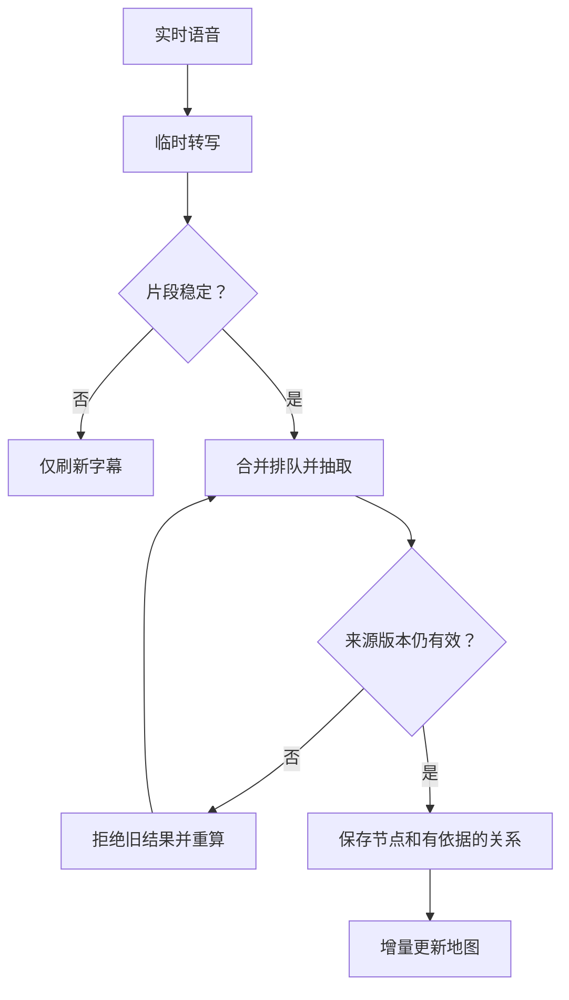

# 知识世界：电脑版 MVP 产品与开发方案

版本：v1.0 · 两轮红队审查后的修订稿

2026-11-13。本文是新开发提案，不修改用户业务基线。依据最新基线 v2 和节点生成实现方案 v0.1。两轮审查针对文档逻辑与范围，不是运行验收；本文未实现产品，未实测延迟、识别率、费用或留存。

**最终建议：先做桌面浏览器里的可持续使用知识世界。**核心投入放在真实语音生长地图、自由整理MD、主动答题升级、自动出现的流程与领域建筑。VC演示重点是可见的资产形成与成长；种子测试重点是用户第二天能否回来继续自己的理解。

技术主线：React/TypeScript＋React Flow，Node/Express＋SQLite，独立ASR与文本模型API；不先做安装包、3D或模型微调。测试月现金预算建议300—400元（不含人工），单人全职20—30人日为规划估计。

## 目标

让正在自学 AI 产品知识的人，把自己的口头理解变成可继续探索、可编辑、可挑战的知识世界。第一版必须让种子用户真实使用，也能在 VC 面前展示一个新知识如何从语音变成地图上的长期资产。三个关键场景：说话长图、关系探索、主动挑战后升级。补足第四个回访场景：第二天回到自己领域建筑做每日巩固，再从旧节点继续探索。通关不代表客观掌握；不做完整课程与资料平台。

## 平台与范围

桌面浏览器 Web，优先 Windows/macOS Chrome 和 Edge，最低宽度 1280；不先做 Electron/Tauri 安装包和手机适配。HTTPS 链接加邀请登录，10—20 名种子用户，单用户多个独立世界，第一轮聚焦 AI 产品/RAG 知识，不承诺全学科效果。

| 范围 | MVP 实现 |
| --- | --- |
| 世界首页 | 卡片、新建、世界名＋初始节点名、最近世界 |
| 输入 | 文字提交＋连续流式语音两条主路径；不单做录音上传。连续记录不自动插嘴；明确显示“正在记录，点击提问获得回复” |
| 节点 | 稳定片段抽取新实体与关系，新增自动落图；别名复用；来源片段；无删除 |
| 连线 | 自动学习延伸、手动连线、虚线关联接受；关系 MD；正式关系不能删除；方向线无 MD |
| MD | 名称、自由 Markdown 编辑、外链/图片链接、题目区；自由区 AI 不覆盖；自动保存及保存状态 |
| 节点挑战 | 5 简答＋10 判断，按需生成并持久化；答题卡；仅 AI 题计入；三档 1/1、3/5、5/10，同步满足 |
| 关系挑战 | 暂缓，关系题量和三档未确定，不能伪装已完成 |
| 建筑 | 真实自动生成一个流程副本类型：识别 3—6 步流程，顺序连线，过关持久化并有可编辑 MD |
| 领域副本 | 纳入轻量真实版本：AI 自动识别领域建筑，打开后生成当日最多10道填空/判断/解答题；复用题卡，跨天保留 |
| 隐藏 | 以初始节点连通性处理整片隐藏；预览影响；初始节点暂不提供隐藏；最近一次隐藏可撤回 |
| 暂不做 | 实操红队项目、社区、排行榜、3D、TTS、RAG 全文知识库、多端同步、多模型设置 |

所有新增细节（如流程步数、初始节点保护）均为本次 MVP 提案，不冒充用户已确认规则。新增“本轮从 A 探索到 B”的来源关系作为正式关系的一种；有当前讨论来源和实体提及证据时可连接，它表示探索来路，不表示 A 导致或包含 B。知识关系证据不足时不虚构因果。无法确定来源时，输入台明确显示识别结果并允许选择来源节点；没有处理出口的静默搁置不接受。

## 页面与视觉

地图为主，深靛蓝背景、细网格和少量青绿光点，主内容用清晰实体名；节点为圆形核心，三档改变环、轨道与结构。关系为低亮实线，建议关联为虚线，方向提示为带问题的短箭头。建筑为明显不同的几何塔形。形状和文字同时区分类别，颜色只辅助。

底部只有输入台，左侧麦克风/实时语音，右侧提交；对话短回复在输入台上方打开可收起卡片。节点 MD 用右侧抽屉，答题卡和流程副本复用该抽屉，保持地图背景可见；不新增固定任务栏和侧边导航。用户拖拽地图、编辑 MD、作答或阅读内容时暂停自动跟随；新增内容先用边缘方向提示，点击“继续跟随”恢复。一次只选当前主要讨论节点，镜头不追逐一句话中的每个名词。

重点打磨三段：稳定文字变成节点并从来源节点拉线（新节点入场 250—400ms）；跨节点接受虚线关联后关系名称显现；答对升级后节点由核心变为带环结构（600ms 内）。地图镜头平移 400—700ms；不要每出现一个词就全图重排。以上为设计目标，不是测得延迟。

## 真实用户与 VC 演示

种子用户从空世界开始，说或输入自己的理解，整理 MD，挑战后选择继续方向；24小时后回自己的领域建筑做题或继续旧节点。VC 现场体验预计4—6分钟，分两段：已有12—20个节点的示例世界→说一段 RAG 理解→新增节点与来源关系→接受一条关联→若其中一个新节点题库已生成，答一简答一判断升第一档；若仍在准备，明确显示“题库生成中”，转到事先真实生成题库但尚未通关的旧节点完成升级，不冒充新节点过关；随后明确切换到示例世界中事先真实完成前置条件的旧流程副本，完成排序并刷新确认保存。新出现的建筑可以仍锁定，不伪装刚升一个节点就解锁整套流程。演示使用同一真实后端，示例数据有标识；网络故障时只能切换明确标记的回放，不把预录当实时。演示中新增节点数仅脚本预期，不能强制模型凑数。

## 技术选型

前端 React＋TypeScript＋Vite，React Flow 自定义节点/边＋Zustand，CodeMirror 6 的 Markdown 源码编辑，react-markdown 渲染并禁用原始 HTML，CSS/SVG 动效。二维图优先，单世界测试目标 150 节点/300 正式边（性能验证范围，不是达到后删除或丢弃内容的配额），不使用 3D 引擎。

后端 Node.js LTS＋Express＋ws，Zod 验证模型结构化输出，SQLite（better-sqlite3，单实例持久卷），单台服务同时提供前端/API；Caddy HTTPS，Docker 部署。邀请码兑换独立会话，服务端按用户隔离世界，不依赖前端隐藏。图片先支持 Markdown 外链，不做附件服务；MD 和世界 JSON 可导出。

ASR 候选首选阿里云 paraformer-realtime-v2，WS 中 sentence_end=false 为临时、true 为最终；中文混英文需要原型验证。模型首选 qwen-flash，同一供应商减少接入；不微调，无 Agent 编排。所有密钥只存服务端。VoxGraph 分段机制＋AudioGraph 稳定转写和来源版本校验自行轻量实现，不搬完整仓库。

实时音频：浏览器 AudioWorklet 采样、转单声道 PCM，经自己后端 WS 转发，临时文字只更新 UI；稳定片段按中文语义和长句兜底分段；抽取任务携带 worldId/sessionId/spanId/revision；旧版本结果拒绝。应用节点＋边时校验引用及范围，单次事务提交并推送增量；前端固定已有位置，只为新增节点找附近空位。自动学习延伸属于探索路径，语义关系不能把用户猜测写成事实。已落图的语义关系更正采用下文的“保留记录、停止使用争议事实、修订后再使用”，不自动删除正式线。

最小数据：User、Session、World(rootId)、TranscriptSpan(revision)、Node(aliases,position,md)、Relation(kind,claimStatus,md,source,revision)、Direction(question)、Question(origin,type,reference,version,basis)、Attempt、Dungeon(version,basis)、DailySet(date)、HideBatch；graphVersion 和已应用 taskId 防止重复落图；没有第二套演示业务逻辑。

模型用例：抽取（实体/关系）、明确提交后对话、按需题目生成、简答判题、流程/领域候选识别。判断题按保存答案判定；判题有解释，不通过可以重答；不同题只算一次。同一题修改参考答案时保留历史版本，AI 验证后另存新版本。题目是否可信靠人工样例评审，不能仅靠模型自我打分。

### 语音到地图的处理图

语音稳定不等于知识断言正确；地图落图校验与题目/副本事实依据仍须分别处理。

## 自动流程副本

图谱新增后进行去抖检测，检测仅基于新增节点邻域及缓存，不每个词扫描全世界。候选要求明确同一过程、3—6 个已有节点、单一合理顺序、每步有来源；未确认的条件为 MVP 提案。出现后锁定；相关节点当前有效第一档均达成才可挑战。流程限定同一个具体过程、同一粒度，保存每个先后约束的来源。程序检查无环及约束下拓扑排序唯一；结构唯一不能证明知识正确，语义仍需来源和人工抽样复核，模型不确定或多解不生成建筑。通过后建筑和 MD 持久化，内容改动后不静默覆盖已完成题目。

## 关系更正、资产编辑与隐藏

以下为 MVP 提案，保留用户已确认的正式关系不能删除这一底线：

- 关系分“探索来源”与“知识命题”两种标签，不增加第三类地图对象；前者只说明本次学习如何延伸，不作为知识事实出题。
- 语义关系可报告“有疑问”；保留线与历史，暂停它作为推荐、出题、领域/流程副本的知识依据；允许修订关系标签与解释，审核后生效并保留旧版本。
- 正式线的结构连接与知识可信状态分开。争议线仍是正式结构连接，按现行隐藏规则参与大陆连通，但不能当成可学习事实；若其两端实体本身误识别，可更正节点名或使用隐藏预览，不能静默删除线。
- 每个题库/副本只记录直接使用的节点、关系及来源版本；不实现通用依赖DAG。直接依据有争议或发生语义修订时，将该题库/副本整体标为待更新，不逐题做复杂溯源；已完成历史不删除。具体档位规则如下。
- 名称误识别可改名，来源可查看；同义实体明确时复用，含糊时不强合并；实体合并/拆分后移。
- 隐藏先在计算用临时图中移除目标及其连线（不删除存储数据），从根节点做无向可达遍历，断开的全部一起隐藏，预览后执行。根节点暂不提供单独隐藏。只承诺最近一次隐藏可撤回，先预览并重新检查连通；后续又做隐藏后，不承诺旧批次自由恢复，完整隐藏管理中心后移。不能越过另一次明确隐藏自动恢复其他节点。
- 邀请码兑换账号后提供个人恢复码，可退出并再次登录；凭证只以哈希保存，敏感操作查ownerId。并发编辑不作为支持场景；控制先用文档revision校验，旧版本保存被拒绝并保留本地草稿、提示重新载入；不做跨设备接管系统或多人实时编辑。
- MD 自由区不由 AI 自动覆盖；图片先为外链，粘贴图片文件给明确提示。用户可修改参考答案，AI通过后另存版本；人工补题可记录，但不进入节点通关计数。

### 题库变化后的通关与形态（本次MVP提案）

| 情况 | 历史形态/档位 | 当前答题与新解锁 |
| --- | --- | --- |
| 依据未变、题库有效 | 按5简答/10判断中不同AI题的累计通过数，达到1/1、3/5、5/10升级 | 可以继续作答并用于新副本资格 |
| 题库依据被标争议 | 已取得最高档位保留，加“历史通关·内容待核对”标记 | 暂停该题库新增通过和依赖它的新副本解锁；不把旧档位当当前有效资格 |
| 用户请求更新，生成新题库 | 旧题库与通过记录保留；历史最高形态不自动降级 | 新题库从0统计有效通过数；达到要求后恢复当前资格，不把旧题完成数复制到新题 |
| AI审核通过参考答案修订 | 记录答案版本和当时作答依据；若属于语义变化，按题库待更新处理 | 不静默改判旧答案；争议流程内仍不能获得新资格 |

等级数字表达历史通关成果，不宣称客观掌握。界面同时显示当前有效题库进度，不用一个亮着的高级外观掩盖已失效依据。为降低MVP复杂度，题库整体更新、人工发起、没有自动后台迁移；这套规则是本轮新建议，未覆盖到用户基线。

## 领域副本最小实现

MVP提案：AI在已更新节点邻域识别一个明确领域，至少4个已有节点、命名不重复、来源可追踪时出现；相关节点至少2个当前有效首档后可挑战。此数值是起始实验配置，单独记录，不等于用户原来定过。

入口是所属领域锚点节点上的塔形建筑，不放独立固定任务栏；打开后才生成当天题组。每个用户每个领域按Asia/Shanghai自然日最多10道新题，首次展示占一个名额，重答原题不新增名额；刷新/退出后从同一题组继续。填空支持保存的标准答案和可接受别名，判断本地判定，解答交AI判定。混合题型，用户可随时退出，无强制打满10题；领域题先不计节点的三档进度，避免不同题库重复记功，此为MVP建议。

领域副本不假设知识一定是线性的；流程副本只承接有明确顺序的过程。两者均由真实当前图谱触发，不能手工建建筑、预埋假建筑或用种子世界条件冒充空世界发现率。

## 等待与输入协议

文字和语音共用底部输入台的“记录／问AI”两个轻量选项，默认记录。记录模式提交后保存来源并更新地图，不强制提供教学回复；问AI模式才发起对话。左侧实时语音只控制采集，右侧提交执行当前选项。首次使用提示写在输入台内，不新增固定面板。

连续语音：点击实时语音→麦克风权限→正在记录（临时字幕、稳定字幕）→稳定片段在后台关联→已保存。语音可以一直记录；点“问AI/提交”发送的是“自上次提交以来尚未发送的稳定片段”，输入台显示其文字范围，可编辑或选择。提交后清空本轮发送缓冲但保留会话来源；后续音频不混入已发送问题，已落图片段也不因提交而重复落图。临时尾句不发送，停止采集后等待最终片段再显示待发送内容。

输入台区分记录中、关联中、已保存、失败可重试。没有新实体时显示“已记录到当前节点”，这里指会话来源记录，不自动覆盖自由MD。可以选来源摘录加入自由区，但须由用户主动操作。AI回复只在段落稳定后抽取实际解释的实体，不扫描每个输出token，也不重新把用户原句当新输入处理。

题目区域有未生成、生成中、可答、生成失败、依据待更新五种状态。题库冷启动设P95≤15秒为初期验证目标，已有题库打开≤300ms为本地UI目标，分别记录，均非实测。生成中仍能编辑MD与浏览地图，不用占位卡冒充已生成题。超过15秒显示继续等待/稍后再来，演示可以明确切换到已生成题库的旧节点。

每个世界最多一个抽取执行任务＋一个可合并待处理缓冲；稳定片段保留，后来的片段合并等待，不为每段无限并发。主动对话优先于未启动的题库/副本任务，已启动调用不假定能抢占。缓冲超过初始30秒稳定音频时显示“关联稍后完成”；超过120秒则暂停采集并保留已稳定文本，用户可继续用文字，防止静默丢内容和无限堆积。阈值为实验配置。

有明确当前讨论节点时，新实体用有来源证据的探索关系自动落图；初始节点是默认讨论来源，用户点击另一节点后可切换。完全无法确定来源时，仅在输入台保留“已识别X，待选择来源”条目，不先建立悬空正式节点；选择来源后才落图。这是异常情况下的MVP取舍，不宣称每个提及都立即出现。

抽取失败保留来源文本、可重试且不重复落图；录音中断明显告知缺口，关闭上游计费连接；未确认文字不标已保存。重连不默默全量重复发送旧音频。稳定片段/会话ID/世界ID/版本共同校验，切换世界不能把旧世界晚返回结果写到新世界。

## 成本与限制

核价日2026-11-13：北京区 Paraformer 0.00024元/秒；Qwen Flash 输入不超过128K的输入0.15元/百万tokens、输出1.5元/百万tokens。不计免费额度与缓存折扣。

标准20分钟会话的工作量假设如下，全部是预算输入，不是实测：

| 用例 | 次数 | 每次输入/输出tokens假设 |
| --- | --- | --- |
| 图谱分段抽取 | 60 | 2500 / 350 |
| 用户主动对话 | 5 | 4000 / 700 |
| 节点题库（每库5简答10判断） | 2 | 2500 / 4000 |
| 简答判题 | 5 | 2000 / 350 |
| 流程/领域检测与流程题生成合计 | 4 | 3000 / 1000 |
| 当日领域10题生成 | 1 | 2500 / 3000 |

其中5次简答判题包含本次节点与领域解答的合计；若领域多做解答、反复重答或编辑答案审核，应另计。合计输入199500、输出41250，文本约0.0918元；20分钟音频0.288元；每会话约0.3798元。20用户×每周3次×4周=240次，API约91.15元/月。若每项次数/上下文加倍或增加判题，费用随之变化；这里不是“最多91元”的承诺。

API先预留约200元/月，服务器50—150元/月和域名/备份预留30元是预算而非供应商报价；测试月现金预算建议300—400元，不含开发人工。每人每天30分钟语音并不保证同时满足全员跑满的预算：20人×30天×30分钟的ASR单项约259.2元，必须有全局费用门槛。

服务端在新调用前保留其预算：ASR按最长会话时长预留，LLM按输入上界和输出上限预留，完成后按usage核销。20分钟/会话、30分钟/人/日、每人每天1元且每月10元应用侧AI额度为起始实验配额；多个领域共用个人额度，避免单人耗尽全体预算；全局API预算200元，达到180元预警并收紧新增任务，余额不足不启动。应用账本不能替代供应商最终账单，另留缓冲处理在途和计费差异。停止/断线主动关闭上游任务。超额后仍能看、编辑、导出已有资产。

## 验收与种子测试

目标（待测）：输入操作反馈<100ms；150/300 图谱拖动中位≥45fps、P95帧间隔目标≤50ms，同时记录>100ms长帧；稳定句结束到有效图谱更新 P95≤4秒；对话首字 P95≤3秒；简答判题 P95≤5秒。记录网络环境、机器、图谱规模及样本，不能只报告最顺一次。连续说话、生成题库、切换世界同时发生也必须测，排队造成的迟延不能排除出统计；若目标不达标先调整调度/范围，再对外说明实际结果。失败有重试/文字回退，不伪装成功。

第一批10—20人试用7天。先独立观察至少5人的空世界首次使用，不用演示世界引导成功；再看全体首次使用完成率（初始参考≥70%）、24小时后无人催促自主回访人数、7天至少两次自主使用人数及是否继续自己的旧节点。回访参考目标≥50%只是探索门槛；同步报告人数/分母，主持人安排和VC演示不计自主回访。记录实际关系错误率、漏节点、无关系等待次数、人工纠错成本，以及副本候选/出现/可玩率。题目完成与节点数是过程数据，不当成学习效果。初始成功阈值是探索性判断，不是统计验证。另对至少5个空世界报告首次建筑出现、首次解锁、首次完成的人数和时间；门槛阻碍可玩率时调实验配置，不手工送建筑。没有建筑时仍可回旧节点，不要求考试后才能继续探索。

## 开发顺序与完成门槛

单人全职＋AI辅助约20—30人日（4—6周）的规划估计，含试用修复，不承诺发布日期。每阶段以完成门槛进入下一步。

| 阶段 | 工作与产出 | 完成门槛 | 估计人日 |
| --- | --- | --- | --- |
| A 核心可行性 | 一条真实中文语音→稳定文本→实体/关系→增量图；50节点的地图与输入台视觉样片（标注模拟） | 连续输入、口误、否定、重复、旧结果晚返回均有可解释行为；先确认位置稳定与内容可读 | 3—4 |
| B 资产闭环 | 世界、邀请账号、MD、来源、更名、隐藏预览/撤回、导出、服务持久化 | 刷新和重启保存，跨账号读写拒绝；恢复演练成功；无覆盖自由MD/隐藏孤岛 | 4—5 |
| C 探索体验 | 实时语音输入台、对话、正式/虚线/方向、镜头与等待状态 | 可以不答题持续记录；不抢编辑焦点；断线/超额有明确结果 | 3—4 |
| D 玩法闭环 | 节点题库/判题/三档、流程副本、领域每日题；统一卡片与建筑组件 | 副本真实自动触发，区分出现与解锁；等级和当前资格一致；失败不升级 | 5—7 |
| E 演示与试用 | 性能、少量动效、真实VC脚本、10—20人7日试用并修复 | 关键发布检查通过；真实使用与示例/回放数据分开；账单与应用台账对照 | 5—10 |

最小20人日、完整上界30人日；不是把每段都取上界后仍称30天。若ASR/抽取质量不达标，先修核心而非堆更多玩法；关系挑战、3D、系统音频录制等不插入本轮。预算紧张时先完成A—C内部验证，不把缺少D的版本宣称为完整种子MVP。

发布前必要验证：真实语音通路；未结束尾句处理；稳定片段旧版本不落图；同任务不重复落图；跨用户和跨世界隔离；并发旧MD保存不覆盖；隐藏不留孤岛；退出/恢复账号可找回世界；判题失败不升级；过期依据不再用于新题与新解锁；备份可恢复。对这些链路做必要集成验证，不为每个CSS动画写机械测试。

## 核查来源

- [产品基线](https://chatgpt.com/library?file_id=libfile_d42c1cf24d348191a29e86dfbe357d5c&account_id=personal)
- [节点实现路线](https://chatgpt.com/library?file_id=libfile_1dc63fa8f4b081918423b23a4ff27923&account_id=personal)
- [React Flow](https://reactflow.dev/)、[性能建议](https://reactflow.dev/learn/advanced-use/performance)；MIT 核心，不购买 Pro 模板。
- [Paraformer 模型与价格](https://help.aliyun.com/zh/model-studio/paraformer-realtime-v2)、[服务端事件](https://help.aliyun.com/zh/model-studio/paraformer-server-events)
- [Qwen Flash 模型与价格](https://help.aliyun.com/zh/model-studio/qwen-flash)。价格核查日2026-11-13，均为北京区对应档位，不跨地域混用。
- [VoxGraph](https://github.com/hammertoe/VoxGraph)、[AudioGraph](https://github.com/Codeseys-Labs/audio-graph)。借鉴机制，未跑通参考仓库。

## 开发交接：哪些是继承，哪些是本次提案

| 状态 | 内容 |
| --- | --- |
| 继承用户基线 | 多世界、地图优先、底部输入、实时语音、自动节点、节点/关系MD、方向无MD、正式关系不可删除、节点题量/阈值、AI自动副本、整片隐藏 |
| 本次MVP新增提案 | 桌面Web、邀请码、探索来源关系标签、关系争议及修订、初始节点保护、流程/领域出现与解锁数值、领域日额度口径、预算与时延目标 |
| 明确延后但不取消产品方向 | 关系判断题与三档、实操项目红队副本、手机端、完整文件/图片上传、全量MD双向同步、实体合并拆分 |

MVP是施工建议，不能写回替代用户已确认基线。关系判断与三档延后，是为了先验证节点成长与两类副本；关系外观只表达选中/争议/关联状态，不冒充关系熟练度。通过本版试用也不能宣称完整基线的所有玩法已验证。

## 视觉与交互制作清单

| 优先级 | 具体制作 | 达到什么效果 |
| --- | --- | --- |
| 必做 | 既有节点位置固定，新增节点从本次来源附近生长 | 让用户认出自己的世界，不被每次重排打散 |
| 必做 | 新增节点、实线关系、虚线建议、问题箭头、塔形建筑各有清晰形状和标签 | 初次用户能区分当前知识、可能关联和下一步方向 |
| 必做 | 临时字幕→关联中→已保存三种真实状态 | 后台等待时能看出系统在工作，保存失败不会假成功 |
| 必做 | 第一档点亮核心、第二档出现环结构、第三档出现多层结构 | 三档看得出变化，同时显示简答/判断完成数；未通关为第一档结构的暗态 |
| 必做 | 镜头只在跟随状态且主要焦点移出视野时平移；编辑/作答时固定 | 有探索感，用户仍能安静阅读和思考 |
| 可后移 | 少量呼吸光、连线描边动画、升级微粒子 | 增强反馈，但不让所有对象持续闪动 |
| 不做 | 3D建筑、全屏爆炸、复杂皮肤、自动旋转镜头、持续力导向抖动 | 留下开发预算给真实语音和资产可靠性 |

视觉提案：深靛蓝背景 #101522，主色青绿 #70DFC8，正文 #E8EEF6，次文字 #A4B0C3；争议状态用图标＋文字而非仅变色。正文至少14px、主要实体名16px；支持减少动画。空世界只显示初始节点及一条地图内提示“说说你现在对它的理解”，不是教学任务。远景显示实体短名与建筑轮廓，近景才显示关系细节；保留搜索定位与回到起点。先验收可读性，再加光效。至少5人看30秒后解释刚才发生什么，再亲自操作，不能只问好不好看。

## 验证和演示如何分开

种子测试聚焦已有AI产品学习需求、愿意带入自己材料的10—20人；不把“喜欢AI的人”视为有效需求。第1天无指导建立一个自己的世界，第2—7天自行返回；访谈问能否找回并继续自己之前的理解、有没有需要却被强制答题或窗口打断。测试中可以不答题、不进副本，仍可记录与探索。

VC的4—6分钟现场演示要解释三件事：说过的内容能变成资产，资产之间有可查看的来路，用户选择挑战后世界会改变。先让VC看到实时输入和真实新增，再邀请其选择一条方向或回答一张卡。用事先已解锁的副本示范组合玩法，并说明它是已有进度。预生成题库可降低等待，但必须是该世界真实生成并保存的AI题；不允许提前写死现场答题必过。

直播、示例数据、离线回放都有明显标签。回放只证明设计和历史运行，不能证明现场模型响应；演示成功也不当作留存证据。

## 开工前仍需验证的关键项

1. 用约30段来自目标主题的中文/英文术语混合表达，人工核对实体、连线、问句和否定；记录严重错线、漏节点与延迟。0条关键知识断言被错误确认为事实，作为这批样例的发布门槛，不外推成全场景零错误保证。
2. 用至少5名不受主持人指导的用户观察：是否看懂记录/提问、是否知道怎么继续、是否被窗口或镜头打断。无法理解时先改交互再加光效。
3. 流程排序有时不唯一。MVP只接纳3—6步、有明确前后约束的线性过程；题目缺乏唯一合理顺序时不出现，不能让AI硬判用户错。非线性体系由领域副本承接。记录空世界副本出现率，不用示例世界代替。
4. 所有新增玩法阈值和题库更新政策保留为MVP实验配置；关系判断题/三档仍需另行定量，不在本版伪造完成。

## 两轮审查后的结论

保留语音生长地图、自由MD、关联探索、节点升级、自动流程与领域副本这一条产品主线。修正了演示解锁不成立、错误关系污染内容、跨天价值不足、题库过期等级不清和首次出题等待未说明的问题；删去通用依赖系统和跨设备接管。详见《电脑版MVP两轮红队审查与修改记录》。两轮审查支持进入核心技术与交互验证，不代替真实用户、供应商或运行验收。

## 部署与资产可靠性补充

首轮仅单实例Node服务＋SQLite持久卷，无Redis/图数据库/微服务。服务端做身份及每个世界owner校验，Cookie用HttpOnly/Secure/SameSite，WebSocket握手同时校验会话和Origin；模型输出只作数据，不执行其代码或原始HTML。麦克风需HTTPS，实际部署地点必须先验证目标用户和模型服务可达性；服务器预算不等于已选好供应商或已完成域名条件。

至少每日使用SQLite一致性备份机制备份数据库和必要文件，保留异机副本；首次邀请种子用户前做一次恢复演练（世界、MD、题目、进度均能读取），试用期间每天检查备份成功。语音原始音频默认不留存，只保存自己世界的来源文字，明确告知哪些内容送往模型。保存成功必须来自服务端持久化确认。个人导出包含本人世界/MD/题目/进度和来源，不导出服务端密钥或他人数据。
